

<a href="https://sherazahmad17.github.io/SherazAhmad17/"></a>

Want the bot to follow your mouse? Open the <a href="https://sherazahmad17.github.io/SherazAhmad17/"><b>interactive version</b></a>.

 


> **AI Full Stack Developer, 2 years of experience.** I build scalable SaaS platforms, APIs, e-commerce systems and AI-powered applications: full-stack development, AI integration, chatbots, authentication, API security, payment integration and deployment.


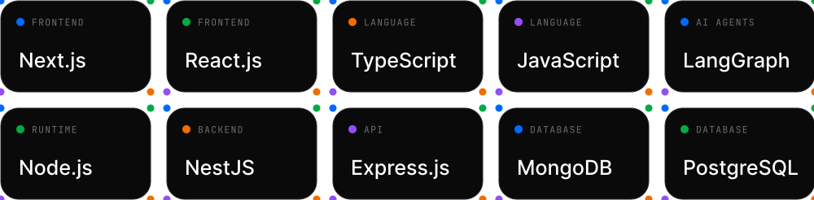


<table>
<tr>
<td width="50%">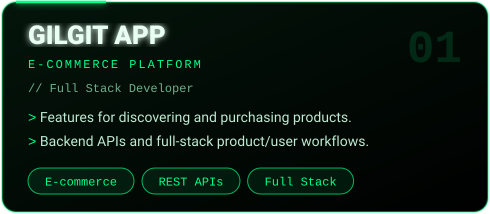</td>
<td width="50%">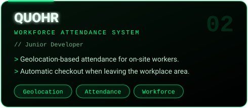</td>
</tr>
<tr>
<td width="50%"><a href="https://github.com/Asiif-07/TEAM_PROJECT">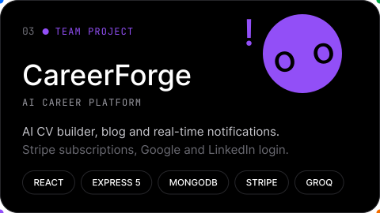</a></td>
<td width="50%"><a href="https://github.com/SherazAhmad17?tab=repositories">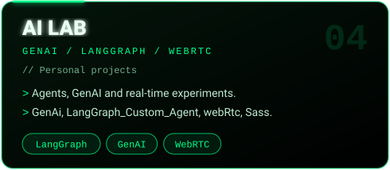</a></td>
</tr>
</table>

[**GenAi**](https://github.com/SherazAhmad17/GenAi) &nbsp;|&nbsp; [**LangGraph_Custom_Agent**](https://github.com/SherazAhmad17/LangGraph_Custom_Agent) &nbsp;|&nbsp; [**webRtc**](https://github.com/SherazAhmad17/webRtc) &nbsp;|&nbsp; [**Sass**](https://github.com/SherazAhmad17/Sass) &nbsp;|&nbsp; [**CareerForge**](https://github.com/Asiif-07/TEAM_PROJECT)

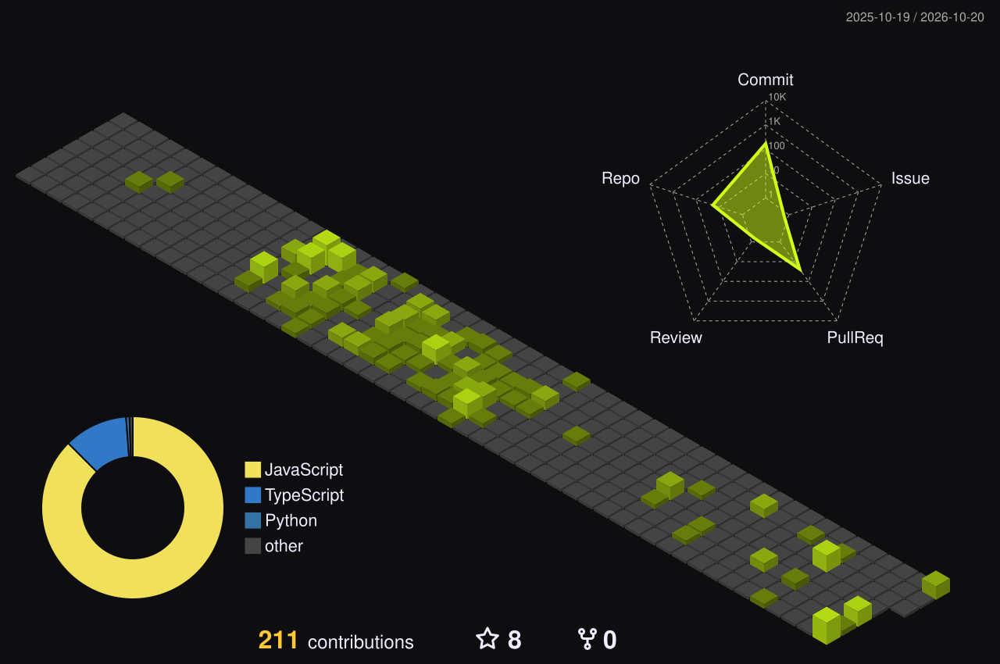

📧 **sherazahmad7434@gmail.com**


