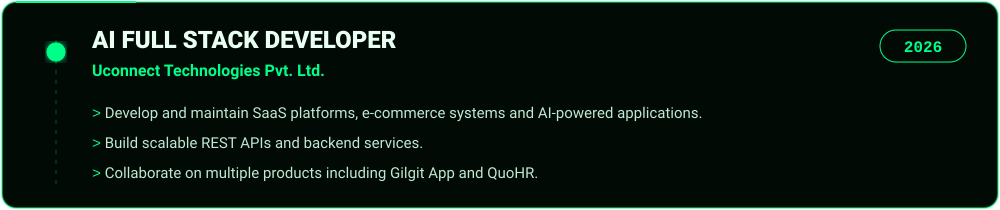

 

> **AI Full Stack Developer, 2 years of experience.** I build scalable SaaS platforms, APIs, e-commerce systems and AI-powered applications: full-stack development, AI integration, chatbots, authentication, API security, payment integration and deployment.

| Area | Technologies |
|---|---|
| **Languages** | JavaScript, TypeScript |
| **Frontend** | React.js, Next.js |
| **Backend** | Node.js, Express.js, REST APIs |
| **Databases** | MongoDB, PostgreSQL |
| **AI** | AI Integration, AI Agents, LangGraph, Chatbots, Tool Calling |
| **Tools & Deploy** | Git, GitHub, Postman, Vercel, Render |

<table>
<tr>
<td width="50%"></td>
<td width="50%"></td>
</tr>
<tr>
<td width="50%"></td>
<td width="50%"></td>
</tr>
</table>

[**GenAi**](https://github.com/SherazAhmad17/GenAi) &nbsp;|&nbsp; [**LangGraph_Custom_Agent**](https://github.com/SherazAhmad17/LangGraph_Custom_Agent) &nbsp;|&nbsp; [**webRtc**](https://github.com/SherazAhmad17/webRtc) &nbsp;|&nbsp; [**Sass**](https://github.com/SherazAhmad17/Sass) &nbsp;|&nbsp; [**CareerForge**](https://github.com/Asiif-07/TEAM_PROJECT)

### 🕒 Latest repositories

<!-- REPOS:START -->
<!-- REPOS:END -->

📧 **sherazahmad7434@gmail.com** &nbsp;|&nbsp; 📍 **Gilgit, Gilgit-Baltistan** &nbsp;|&nbsp; 🗣️ **English, Urdu**

