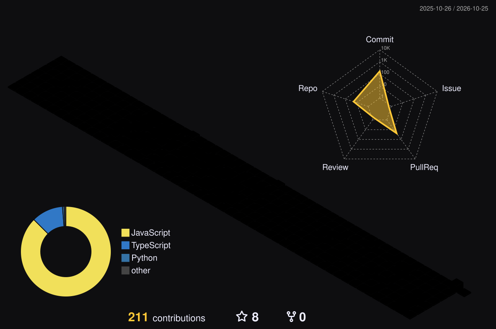

<div align="center">


<br/>

<a href="mailto:sherazahmad7434@gmail.com"></a>


</div>


<table>
<tr>
<td width="58%">

I'm an **AI Full Stack Developer with 2 years of experience** building scalable SaaS platforms, APIs, e-commerce systems and AI-powered applications.

I work across the whole product: **full-stack development, AI integration, chatbots, authentication, API security, payment integration and deployment.**

```js
const sheraz = {
  role: "AI Full Stack Developer",
  experience: "2 years",
  company: "Uconnect Technologies Pvt. Ltd.",
  focus: ["SaaS", "AI Agents", "REST APIs", "E-commerce"],
  languages: ["English", "Urdu"],
  motto: "Code and Repeat",
};
```

</td>
<td width="42%" align="center">


</td>
</tr>
</table>


<div align="center">


</div>

| Area | Technologies |
|---|---|
| **Languages** | JavaScript, TypeScript |
| **Frontend** | React.js, Next.js |
| **Backend** | Node.js, Express.js, REST APIs |
| **Databases** | MongoDB, PostgreSQL |
| **AI** | AI Integration, AI Agents, LangGraph, Chatbots, Tool Calling |
| **Tools & Deploy** | Git, GitHub, Postman, Vercel, Render |


<table>
<tr>
<td>

### 🚀 AI Full Stack Developer · 2026
**Uconnect Technologies Pvt. Ltd.**

- Develop and maintain SaaS platforms, e-commerce systems and AI-powered applications.
- Build scalable REST APIs and backend services.
- Collaborate on multiple products including **Gilgit App** and **QuoHR**.

</td>
</tr>
</table>


<table>
<tr>
<td width="50%" valign="top">

### 🛒 Gilgit App
`E-COMMERCE PLATFORM` · *Full Stack Developer*

- Built features for a platform to discover and purchase products.
- Developed backend APIs and full-stack functionality for product and user workflows.

</td>
<td width="50%" valign="top">

### 📍 QuoHR
`WORKFORCE ATTENDANCE SYSTEM` · *Junior Developer*

- Worked on a workforce management and attendance platform using geolocation.
- Implemented location-based attendance tracking for on-site workers.
- Supported automatic checkout when workers leave the designated workplace area.

</td>
</tr>
<tr>
<td width="50%" valign="top">

### 💼 CareerForge
`CAREER PLATFORM` · *Team project*

- AI-assisted CV builder with templates and PDF/DOCX import.
- Blog with likes and comments, real-time notifications (Socket.IO), Stripe subscriptions, Google/LinkedIn login.
- **React · Vite · Express 5 · MongoDB · Stripe · Groq**

[**View the code →**](https://github.com/Asiif-07/TEAM_PROJECT)

</td>
<td width="50%" valign="top">

### 🤖 AI and real-time experiments

- [**GenAi**](https://github.com/SherazAhmad17/GenAi) - GenAI basics to advanced
- [**LangGraph_Custom_Agent**](https://github.com/SherazAhmad17/LangGraph_Custom_Agent) - custom agent workflows
- [**webRtc**](https://github.com/SherazAhmad17/webRtc) - peer-to-peer video and audio
- [**Sass**](https://github.com/SherazAhmad17/Sass) - school SaaS application

</td>
</tr>
</table>


<div align="center">




</div>

### 🕒 Latest repositories

<!-- REPOS:START -->
<!-- REPOS:END -->


<div align="center">

📧 **sherazahmad7434@gmail.com** &nbsp;·&nbsp; 📍 **Gilgit, Gilgit-Baltistan** &nbsp;·&nbsp; 🗣️ **English, Urdu**

_Open to collaboration. Let's build something great together._


</div>
